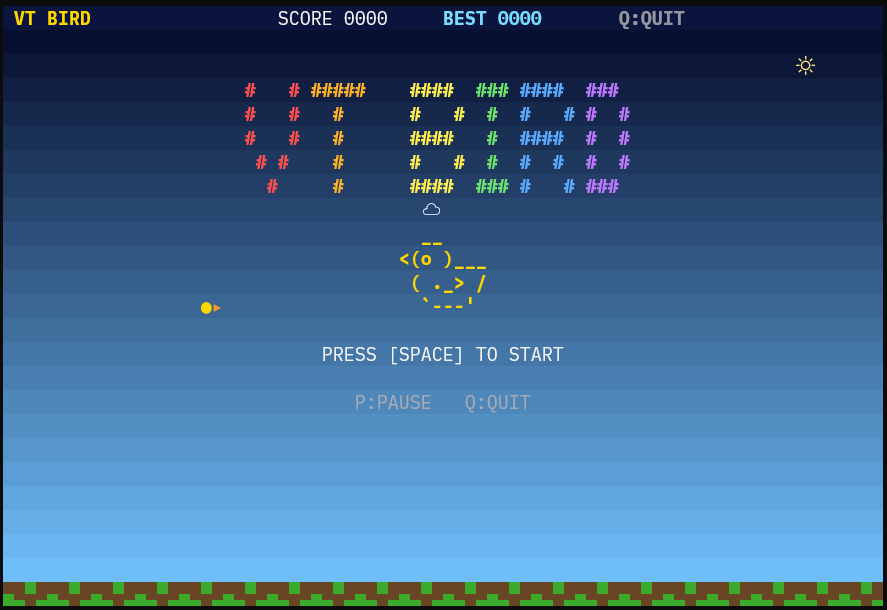

# VT Bird

**飛ぶ。かわす。もう一度。**  
80×25文字のターミナルが、小さな空になる。

VT Bird は、VT互換ターミナルで遊べる **Flappy Bird風のワンボタン・アクションゲーム**。  
スペースキーで鳥を羽ばたかせ、次々に現れるパイプの隙間を抜けよう。操作は簡単。でも、スコアが伸びるほど空は手強くなる。



**▶ [プレイ動画を見る（MP4）](vtbird.mp4)**

## この小さな空の見どころ

- **スペースキーひとつで飛ぶ** — 押すと上昇、離すと重力で下降。リズムとタイミングが勝負。
- **進むほど難しくなる** — スコアに応じてパイプが速くなり、通り道も狭くなる。
- **ターミナルなのにカラフル** — 空のグラデーション、流れる雲、太陽、色づいたパイプと鳥。
- **失敗しても、すぐ次の一羽** — リトライはもちろん、スコアを引き継ぐコンティニューにも対応。
- **追加パッケージ不要** — Python標準ライブラリだけで動作。30 FPS、差分描画で軽快に描く。

## 遊び方

パイプの**隙間を通過すると +1 点**。パイプや地面にぶつかるとゲームオーバー。鳥は画面の左側に留まり、ステージが右から左へ流れていく。

| キー | 操作 |
| --- | --- |
| `Space` | ゲーム開始／羽ばたく／ゲームオーバーからコンティニュー |
| `C` | コンティニュー（ゲームオーバー時） |
| `P` | 一時停止／再開 |
| `R` | 最初からリトライ（タイトル画面以外） |
| `Q` | 終了 |

`Enter` も `Space` と同じ操作として使える。

**コンティニューとリトライの違い**  
コンティニューはスコアを維持し、鳥を中央に戻して近くのパイプを取り除いて再開。リトライはスコアを0に戻して、新しく挑戦する。ベストスコアは**プログラムを起動している間**だけ保持される。

## さっそくプレイ

### 必要な環境

- Python **3.8以上**（外部ライブラリのインストール不要）
- **80列×25行以上**のVT互換ターミナル
- `termios` と `fcntl` が使えるUnix系環境（Linux、macOS、WSLなど）

> WindowsのネイティブPython環境では、Unix系の端末制御モジュールを使用しているため、そのままでは動作しません。WSLなどを利用してください。

### 起動

```bash
git clone https://github.com/maguro-osakana/vtbird.git
cd vtbird
python3 vtbird.py
```

起動時に**色モード**と**文字セット**を選べる。Enterだけ押せば、TrueColor＋Unicodeが選択される。

設定を毎回選ばず、すぐ遊びたいときは：

```bash
python3 vtbird.py --truecolor --unicode
```

### 端末に合わせて選ぶ

| 色モード | オプション | 特徴 |
| --- | --- | --- |
| TrueColor | `--truecolor` | なめらかな空のグラデーション |
| 256色 | `--256` | 256色パレットによるカラフルな画面 |
| 16色 | `--16` | 色数の限られた端末向け |
| 色なし | `--no-color` | モノクロでシンプルに |

| 文字セット | オプション | 特徴 |
| --- | --- | --- |
| Unicode | `--unicode` | 鳥・雲・太陽・パイプを記号で表現 |
| ASCII | `--ascii` | 基本的なASCII文字を使った描画 |

たとえば256色で遊ぶなら：

```bash
python3 vtbird.py --256 --unicode
```

文字化けが気になる環境では、ASCII＋色なしも試せる。

```bash
python3 vtbird.py --no-color --ascii
```

オプションを省略した場合、自動検出はせず、未指定の項目だけ起動時に尋ねる。

## ちょっとだけ技術の話

VT Bird は、ゲーム画面を **80×25の文字セル**として組み立て、ANSI/VTエスケープシーケンスで描画している。通常のフレーム更新では**変化したセルだけ**を描画して、端末への出力を抑える。

- `select` によるキー入力待ちとフレーム待機
- 固定30 FPSのゲーム更新、重力とフラップ速度による鳥の移動
- スコアに連動するパイプ速度と隙間の調整
- 対応端末での描画のちらつきを抑えるDEC 2026同期更新
- 終了時の端末設定・カーソル表示の復元

描画も入力も、使っているのはPythonの標準ライブラリだけ。


---

**次のパイプを、あと一本。**  
さあ、`Space` を押して飛び立とう。
